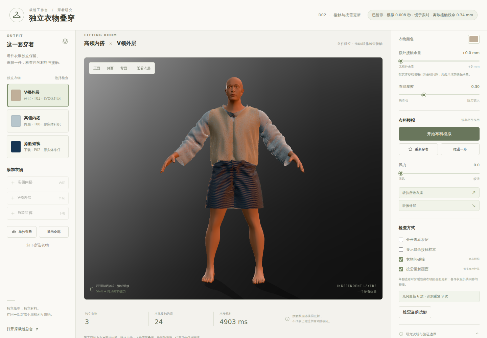

# R02 公网发布后的操作复核

[打开固定 R02 工作台](https://haihao0307.github.io/guilin-dem-pipeline/kaopu-tailor-workbench/material-products/layering-r02-20261020-5186f8a/) · [成功的公网补验](https://github.com/haihao0307/guilin-dem-pipeline/actions/runs/39406909155) · [机器可读检查记录](PUBLIC_CI_BROWSER_CHECK.json)

## 结果

2026-10-20，使用 GitHub Actions 的 Chromium / SwiftShader 直接打开固定 HTTPS 地址，公网单步与接触测量补验通过。没有重新构建或启动本地站点，也没有替换网络资源。源码仍为 `5186f8a5d71a5e75059539f83a31b2ba1e53042b`，发布树仍为 `ed1eab6a64669a9da4618e53161fda31e7dd7d6e`。

- 原人物、原查看器和原材料；高领内搭、V领外层、原款短裤分别保留，三衣均实际运动。
- 页面按钮只推进一个物理步：时间由 0 变为 1/120 秒。真实 Worker 请求仅 `init → step → snapshot`。
- 手动接触检查接收新的测量回复；衣物几何、步数和物理时间均保持不变，检查前后画布 PNG 原字节相同。
- 最大边拉伸比 1.4470879759683102，接缝间隙 0 mm，衣间接触厚度残余 0.3387128190904115 mm，均在原门槛内。
- 手动检查覆盖 9,402 个衣物顶点和 18,280 个衣物三角形。当前这一步的人体内部衣顶点、顶点半厚度缺口和人体三角特征包络半厚度缺口均为 0。这里没有重跑独立完整三角相交审查，不能把这些诊断扩大为任意动作的连续防穿插保证。
- 88 个页面请求均收到 HTTP 200，没有应用资源失败、页面异常或应用控制台错误。浏览器自行请求的站点根目录 `favicon.ico` 仍返回 404，已单独验证并保留该条控制台记录。

## 实际截图

下面是本次固定公网地址在完成一步和手动接触测量后的原始浏览器 PNG；仅模拟了 0.008333333333333333 秒。它不是用户本机截图，也不是持续模拟 2.1 秒的旧 CI 图片。

## 性能与验证范围

本次单步求解为 4902.9 ms，物理时间仅推进 1/120 秒；整个短检查约 197.633 秒，包含公共资源载入、软件 GPU 渲染、截图及检查开销。求解仍远慢于实时，这些 CI 时长不是用户设备帧率，也不是前后版本的净加速比例。

之前的六项完整验收继续有效，详见[完整验收运行](https://github.com/haihao0307/guilin-dem-pipeline/actions/runs/39391889463)和[固定发布说明](https://haihao0307.github.io/guilin-dem-pipeline/kaopu-tailor-workbench/material-products/layering-r02-20261020-5186f8a/RELEASE_NOTES.md)。本次仅补验公网加载、实际单步、只读接触测量与画面，不替代持续模拟、隐藏后恢复和卸下再穿回的既有验收。

## 如实保留的未通过尝试

- [连接本机 Chrome](PUBLIC_BROWSER_CHECK.json)：浏览器控制连接 HTTP 401，未在该环境执行物理步或接触检查。
- [独立云端 Chrome](PUBLIC_CLOUD_BROWSER_BLOCKED.json)：WebGL 上下文创建失败，普通重载后相同；未执行物理步或接触检查。[原始失败截图](tailor-r02-cloud-webgl-blocked-1792488751875.jpg)。
- [首轮公网 CI](ci-public-smoke-39406172235/public-smoke-summary.json)：实际操作、身份、数值和画面检查均已完成，最终控制台归因因浏览器 favicon 请求未进入页面网络事件而失败；原始 `passed:false` 记录保留。检查脚本新增对同一 favicon URL 的显式 HTTP 404 取证后，仅将这条精确记录归为非应用资源错误；没有放宽物理或应用错误门槛。

成功与失败两轮的原始 JSON、PNG、压缩 Worker 检查点和远端运行身份记录全部同目录保留。源码 PR #315 与检查 PR #320 均保持 Draft、未合并；原 R01 和其他并行项目保持不变。母项目接入范围仍见 [INTEGRATION_SCOPE.md](INTEGRATION_SCOPE.md)。
