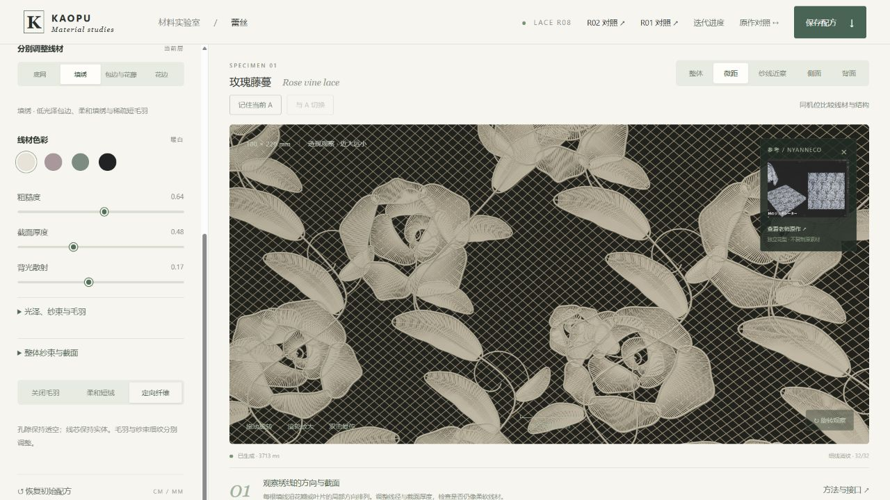
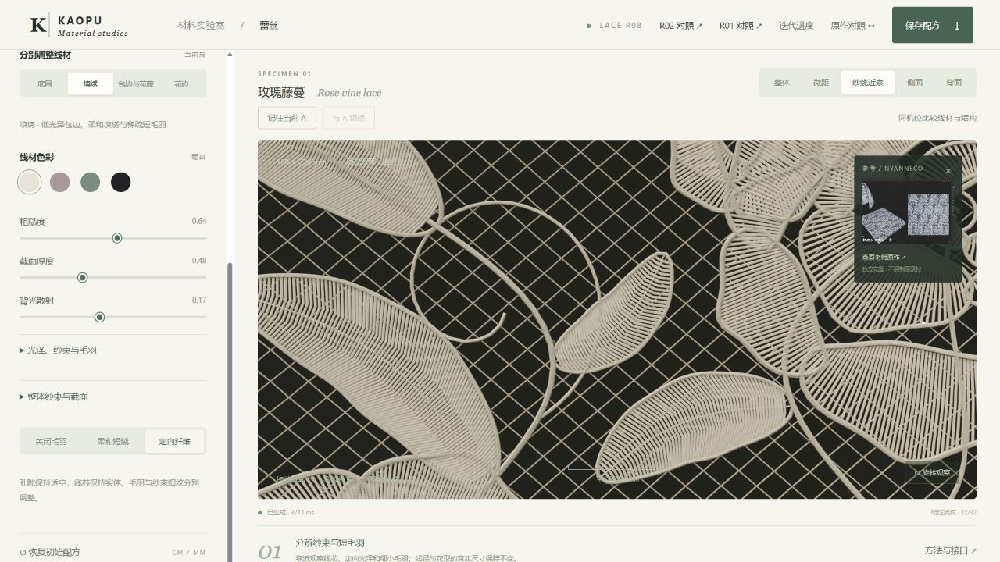

# 蕾丝视觉调参 R08 · 研究候选

2026-10-25。视觉优先。R05.1–R08 第一轮功能已实现，真实样布质感验收尚未通过。原 R05 在线地址保留，本候选只通过 Draft PR 审阅。

## 逐步结果

| 步骤 | 效果 | 回看 |
|---|---|---|
| R05.1 | 修复启动控件遍历与配方版本，保留原几何、材质 | [基线 HTML](../r05.1-20261025/index.html) |
| R06 | 四层线材独立调节，分离纱束细纹与短毛羽 | [R06 HTML](../r06-20261025/index.html) |
| R07 | 间距与线径独立，增加受控起伏、Z 分组、底网松弛 | [R07 HTML](../r07-20261025/index.html) |
| R08 | 三材质配方、同机位 A/B、完整保存恢复、纱线近察与进度面板 | [最新 HTML](index.html) |

页面右上角“迭代进度”可随时查看已实现和待完成项目。材质配方是视觉方向；当前纱线仍偏硬，底网偏规整，宽面光下柔棉与丝光差异仍较弱。

## 后续顺序

1. R09：同尺度参考校准，优先处理线体硬感、柔棉/丝光差异、短毛羽轮廓与背光层次。
2. R10：明确蕾丝工艺，核对底网、连接、连续线径与背面载纱。当前网格和 Z 分组没有通过工艺拓扑验收。
3. R11：完整运动闪烁检查、实际 GPU 帧耗、多设备与 file 协议运行验收。
4. R12：材料候选通过后接入服装重力、贴合、碰撞和拉伸。

## 已核验与限制

33 项自动检查通过；后台浏览器检查三花型、五视角、材质、配方恢复、预算拒绝与静止采样。RTX 4070 Ti SUPER / ANGLE D3D11 后端，静止 32 样本、旋转 4 样本。没有实际 GPU 帧耗，不能据此声称目标设备性能通过。

所有核心模块、图片和样式已封装在 index.html，静态依赖检查通过。但后台浏览器 URL 策略拒绝 file://，实际双击运行仍未验证。没有通过真实参考质感、明确工艺、成衣物理验收；弯曲仅用于观察，端点附着约束不等于碰撞求解。

源码维护于 `haihao0307/Human-Fabric-Workbench` 的 `experiments/lace-visual-r08-20261025/`。基线及散列见 BUILD_MANIFEST.json，完整状态见 STATUS.json。保留 Three.js MIT 声明与原页面参考图署名。截图用于检查，不是工作台的运行依赖。
