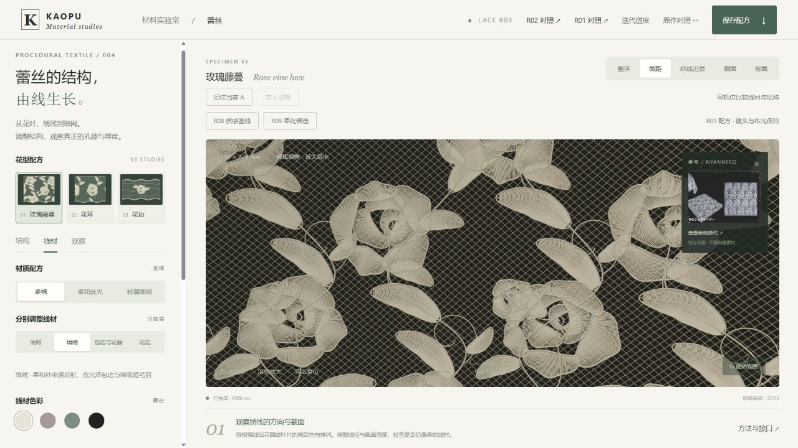
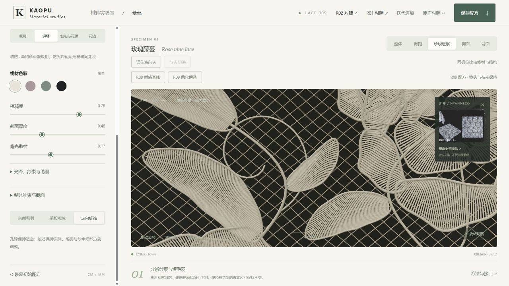

# KAOPU 蕾丝质感候选 R09

2026-10-25。接续 R08 的视觉优先迭代。**本轮修复了短针脚毛羽分配，并加入柔弯、相关松弛与纱束光感控制。视觉提升仍是局部的，没有通过真实样布质感验收。保持 Draft。**

本目录只包含独立工作台与最终证据。[开发源码、构建工具、测试与完整实验记录](https://github.com/haihao0307/Human-Fabric-Workbench/tree/codex/lace-visual-controls-20261025/experiments/lace-visual-r09-20261025) 维护于源仓。

直接打开独立 `index.html` 进行调参。所有运行代码、Three.js、着色器、样图和样式都在这个文件里。HTTP 浏览器运行已检查；当前自动浏览器的安全策略拒绝 file://，实际双击运行门槛仍未完成。

## 各步效果

| 步骤 | 已实现与观察结果 | 尚未解决 |
|---|---|---|
| 分层光感 | 新增柔和度、光泽展宽，柔棉降低硬反光；保持实体线芯和镂空 | 近景仍有规则线杆感，宽面光下材质差异仍有限 |
| 自然粗细 | 真实毫米尺度的相关半径变化；毛羽根跟随变化后的实际三角表面 | 不是完整纱束/纤维体积散射 |
| 底网自然松弛 | 两族网线共用变形场，保持实际交叉节点；不增加段数 | 底网仍是通用交叉网，没有明确工艺认证 |
| 针脚柔弯 | 相关弧线细化，保留端点、线径及旧 Z 样点；转折更平顺 | 默认整布 6 组风险花瓣保留原针路；计算开销较大 |
| 短针脚毛羽 | 修复逐路径取整清空毛羽的问题，按整层弧长分配 | 极细轮廓与运动稳定性还需要同尺度参考和运动检查 |
| 调参效率 | 相同结构复用曲线，只重建受影响层；实际毛羽长度修改只重建 fill | 结构变更仍可能需要数秒，未做目标设备 GPU 性能验收 |

[拖动查看 R08 / R09 同机位截图对照](qa/compare.html)。这份截图对照只是检查记录，实际工作台仍是上面的独立 HTML。

## 如何比较与调参

1. 页面中“R08 质感基线 / R09 柔化候选”切换当前材质配方、底网松弛与柔弯候选，保持花型、线径、镜头和布光。按钮会重置相关线材参数；自定义变化可先用“记住当前 A”保存对照。
2. “结构 → 针脚柔弯”可单独关闭观察；“连续密绣”明确关闭柔弯并使用旧线径驱动的密度，“透空绣线”恢复本版组织候选。
3. “线材 → 光泽、纱束与毛羽”中调整每层柔和度、光泽宽度、自然粗细和短针脚毛羽均衡。均衡是 0/1 开关；毛羽密度使用 0.01 步进，避免预设值被滑块悄悄四舍五入。
4. “观察”中切棚光、掠射光和背光。“叠层投影”保留为可选对照，默认关闭，不因新增功能就默认增加阴影成本。
5. 保存 JSON 会记录新结构和材料控制、图层、灯光、镜头、截面与毛羽模式。R09 生成器标识为 `procedural-lace-r09`；R08 配方仍由保留的 R08 工作台读取，不静默改写旧配方。
6. 右上角“迭代进度”列出已实现与后续工作。超出 250,000 段会明确拒绝并回退到上一次成功布样，不自动降低密度。

## 必须说明的成本

默认玫瑰藤蔓、18 × 22 cm、0.18 mm 间距、柔弯 0.75、底网自然松弛 0.65，四层全部可见、定向毛羽：

| 指标 | R08 质感基线 | R09 候选 |
|---|---:|---:|
| 曲线段 | 171,191 | 239,875 |
| 主体三角形 | 2,506,320 | 3,605,264 |
| 毛羽根数 | 49,517 | 75,025 |
| 毛羽三角形 | 396,136 | 600,200 |
| 显示几何合计 | 2,902,456 | 4,205,464 |

**不能说几何成本没有增加。** 自然粗细和底网松弛不加拓扑，但柔弯增加 68,684 段，毛羽分配及配方校准增加 25,508 根。毛羽仍受同一批路径的旧完整密度上限约束；该上限不等于当前 R08 配方实际使用量。

柔弯按花瓣检查新边界穿出和新增针脚交叉，默认 652 组接受、6 组保留原路，页面直接显示数量。该检查没有证明完整三维碰撞或真实针法正确。不同花型的完整统计见 [geometry-cost.json](qa/geometry-cost.json)。

## 验证与限制

- 71 项检查通过：旧行为保留、新参数边界、确定性、真实折线交点、柔弯安全检查、毛羽总预算与附着、配方恢复、队列、实际几何与重建缓存键一致，以及独立 HTML 的模块依赖/散列。
- 后台 Chromium / ANGLE，RTX 4070 Ti SUPER D3D11 后端。检查三花型、三材质、五视角、棚光/掠射光/背光、密绣与透空、预算拒绝与回退。
- 实际下载并载入的 JSON 恢复了填绣柔和度 0.42、毛羽长度 1.50 和纱线近察镜头。调整毛羽长度时，页面证据记录只重建 fill。预算失败回归实测保留柔和度 0.42、烟粉颜色与柔和短绒模式，结构间距回退到 0.18 mm。
- 静止 32 样本；没有真实 GPU 帧耗或多设备帧率结论。一次诊断页与正常预览同时运行时出现响应变慢，关闭诊断页后恢复；多页面稳定性仍待验证。
- 孔隙和线芯分离，未靠整体透明、发光或图片替代几何。粗糙度诊断图证实细线的最终粗糙度会被屏幕导数过滤提高；没有为追求亮点而取消抗走样。
- 背光仍有局部硬亮点，毛羽轮廓的自然程度尚不足。当前候选不能称为参考质感通过、生产可用或工艺准确。
- 原有观察弯曲与端点附着保留；没有新增成衣重力、接触、碰撞或拉伸求解。
- file://、完整运动闪烁、同尺度真实样布与手机/其他 GPU 验收仍未完成。数值检查和截图不替代这些门槛。

## 后续方向

1. 先处理背光局部硬亮点和细线高光被过滤后材质趋同的问题，用固定小样、多方向布光和真实样布逐项校准。
2. 改善极近景纤维轮廓，并优化柔弯的视觉收益与计算开销；保留失败候选及同机位证据。
3. 再处理明确工艺的底网节点、连续连接与背面载纱；当前通用交叉网保留作对照。
4. 材料候选通过后再接入成衣物理。视觉为第一优先，物理验收单独记录。

## 维护与来源

基线为 `Human-Fabric-Workbench@7627ad77eace84e1c7b66cf61b756ee0efdc587c` 的 R08。R08、R07 及在线原 R05 都保留。R08 对照模块冻结在 `tests/baseline-r08/`；仅 Three.js import 指向本目录 vendor，便于独立运行检查。更早的 R05 对照仍保留在 `tests/baseline/`。

开发检查：`python build-standalone.py`、`node --test tests/*.test.mjs`。`tools/measure-look.mjs` 重算确定性几何成本，`tools/build-comparison.py` 重建内嵌截图对照。它们不是用户打开工作台的前提。Three.js MIT 声明与原页面参考署名保留。

`index.html?diagnostic=roughness` 是维护用最终粗糙度灰阶诊断；普通入口默认关闭。`BUILD_MANIFEST.json` 记录模块和独立 HTML 散列，`STATUS.json` 记录已完成项和未通过门槛。按既有质量计划保持 Draft，不覆盖旧版本、不直接部署。
