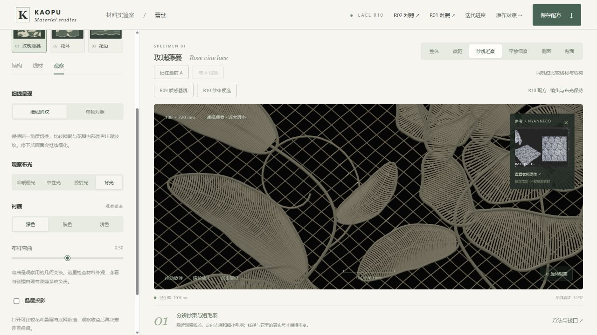
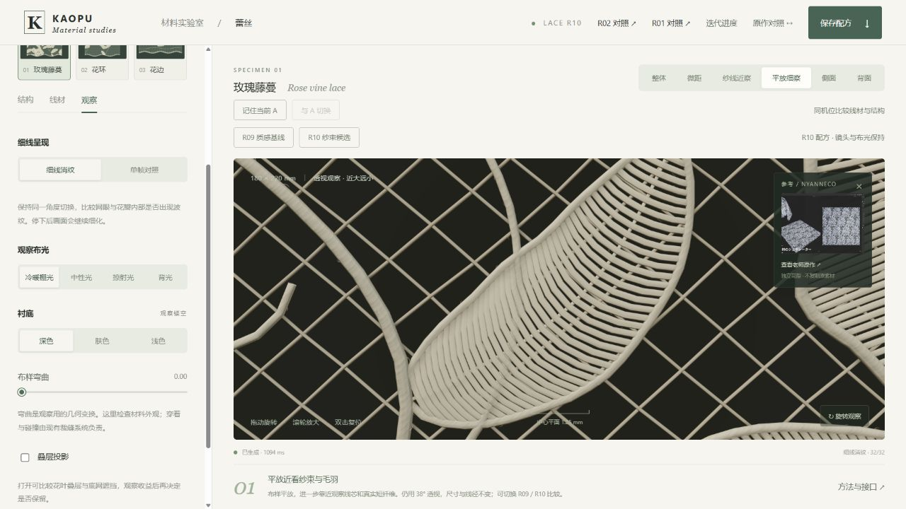

本目录包含独立工作台与精选证据。[源码、构建工具、完整测试和实验记录](https://github.com/haihao0307/Human-Fabric-Workbench/tree/codex/lace-visual-controls-20261025/experiments/lace-visual-r10-20261025)在源仓维护。

# KAOPU 蕾丝质感候选 R10

2026-10-25。接续冻结的 R09，视觉优先。**背光尖亮点减弱，光泽控制和毛羽调参更完整；整体仍有规则线材感，真实样布质感验收未通过。保持 Draft。**

运行本体为独立 `index.html`，全部代码、Three.js、shader、参考图片和样式已经嵌入。HTTP 后台浏览器已检查。当前会话的浏览器 URL 安全策略不允许 file://，因此 R10 实际双击运行仍未验证；封装检查不能替代这个门槛。

## 本轮步骤与效果

| 步骤 | 已完成与当前效果 | 仍需改进 |
|---|---|---|
| 纱束光照 | 用线材方向控制反射、绒光和背光，沿真实灯光与阴影路径计算；棉感背光的尖白点明显减弱 | 这是归一化角分布近似，并非完整纤维 BSDF 或真实样布拟合 |
| 光泽调参 | 纱束散射完全启用时，粗糙度、定向光泽、柔和度和展宽仍分别有效；归零保留 R09 shader 与缓存键 | 普通视角下柔棉、丝光的差异仍较克制 |
| 毛羽表示 | 共用模板绘制真实短纤维，独立控制丰度与少量长毛羽；根附着实际线芯表面 | 高丰度的普通视角收益较弱，最终默认丰度为 0，原根数保留；高丰度作为可选候选 |
| 近距观察 | 新增“平放细察”，明确放平布样，再用同一 38° 透视镜头靠近；未放大线径 | 近看仍能看到规则填线与简化的束纹 |
| 调参效率 | 法线循环复用每圈不变量，毛羽直接分配存储；线芯和毛羽缓存分开，毛羽独改只更新对应层毛羽 | 没有实际 GPU 帧耗或跨设备性能结论 |

[棚光 / 掠射光 / 背光滑动对照](qa/compare.html)包含浏览器原始截图，不是三维工作台的替代品。

## 如何比较与调整

1. “R09 质感基线 / R10 纱束候选”保持镜头、灯光、花型和线径，切换相关材质参数。R09 的全部旧系数与零值新字段单独冻结；旧 R09 文件仍保留。
2. “线材”先调“纱束散射”，再展开“光泽、纱束与毛羽”。粗糙度控制基础纵向宽度，定向光泽控制轴向相干度，柔和度控制较宽纤维群的占比，光泽展宽控制周向扩散。
3. “毛羽丰度”增加实际纤维数量，因而增加提交三角形；默认 0 保持 R09 根数。“少量较长毛羽”只选择并延长已有纤维，不增根数或半径。毛羽长度、可见度和关闭开关仍独立有效。
4. “平放细察”会将观察弯曲明确设为 0；其他相机按钮保持当前弯曲。R09/R10 切换保留这个观察状态。中心平面标尺继续用实际 cm/mm 标定。
5. 保存会下载 version 2 完整 JSON，生成器为 `procedural-lace-r10`。新参数、实际弯曲、图层、灯光和镜头全部保存；R09 配方继续由原 R09 读取，不静默改写。
6. 核心曲线超过 250,000 段、或新实例毛羽每层超过 300,000 根时明确拒绝；不自动减少密度。保存和载入在应用状态前预检毛羽预算。密绣模式明确显示“随线径”，透空模式恢复独立间距。

## 实际默认成本

玫瑰藤蔓 18 × 22 cm、间距 0.18 mm、柔弯 0.75、四层可见、定向毛羽：

| 指标 | R09 基线 | R10 最终默认 |
|---|---:|---:|
| 主体三角形 | 3,605,264 | 3,605,264 |
| 毛羽根数 | 75,025 | 75,025 |
| 毛羽三角形 | 600,200 | 600,200 |
| 提交三角形合计 | 4,205,464 | 4,205,464 |
| 毛羽属性与索引缓冲 | 33,929,304 B | 4,203,032 B |
| 主体与毛羽缓冲合计 | 207,870,208 B | 178,143,936 B |

最终默认毛羽缓冲减少约 87.6%，全部几何缓冲减少约 14.3%。这些是实际 typed buffer 大小，不是浏览器总内存、总显存或帧率。

默认棉感有 5,853 根确定性长毛羽，占原有根数约 7.8%。被选择的轴向长度倍率为 2.4–4.2，离芯高度倍率为 2.0–3.5，再乘独立长度控制；真实半径和附着点不变。丝光、细网使用更少的长毛羽。

高丰度试验曾使用 191,216 根、5,134,992 个总三角形。普通视角收益不足以默认增加这些绘制量，因此保留为调参候选。其成本记录在 `qa/high-richness-cost.json`，不是最终默认成本。完整九个花型/材质组合见 `qa/fuzz-richness-cost.json` 与 `qa/geometry-cost.json`。

保形优化另做了独立 Node 进程测量：在根数不变的 75,025 根试验中，毛羽构建 CPU 中位数约 560 → 432 ms、峰值进程 RSS 约 432 → 282 MiB（原记录单位 KiB）。主体构建中位数约 2301 → 1579 ms，但范围明显重叠、桌面负载波动较大，不能承诺稳定提速。这些都不是当前浏览器 GPU 帧耗。

## 验证与证据边界

- 105 项检查通过，覆盖旧行为、真实几何缓冲字节、可选实例展开误差、连续曲线边界、确定性与预算、光泽控件响应、角分布归一、状态保存和缓存依赖；最终独立 HTML 的嵌入依赖与散列另行检查通过。
- 主体位置、法线、UV、切线与索引保留 R09。法线循环优化只有计算位置移动；多花型、多材质、边界参数和完整填绣均做了真实 buffer 对照。
- 实例与 CPU 参考曲线的位置误差上界测试为 1.1e-6 cm，切线分量误差为 2e-7；这不是视觉参考或工艺验收的容许误差。
- 真实后台 Chromium / ANGLE，RTX 4070 Ti SUPER D3D11 后端。三花型、三材质、整体/微距/近察/平放/侧背面、多布光、密绣/透空、保存恢复与预算拒绝已检查；静止收敛到 32 样本。
- 实际下载的 JSON 恢复了填绣散射 0.42、丰度 0.35、长毛羽 0.40、弯曲 0 和平放近察镜头。毛羽修改的页面证据显示 `yarnRebuiltLayers` 为空、`fuzzRebuiltLayers=fill`。
- 随后的超密失败保留散射 0.43、丰度 0.35、长毛羽 0.40，间距回退 0.18；超毛羽预算的 JSON 在载入前拒绝，当前版本和镜头不变。
- 角分布归一不等于完整 BSDF 能量认证。新的线芯背光沿真实灯光阴影计算，但不透明线芯的自遮挡仍会压掉通过光，没有体积穿透求解。毛羽继续使用原来的轻量受光近似。
- 当前仍有规则细杆感。毛羽轮廓、材质区分、同尺度真实样布、完整运动闪烁、实际 GPU 帧耗和多设备结果尚未验收。观察弯曲不代表重力、接触、碰撞或拉伸求解。

## 已记录的局部结构问题

冻结 R09 的 30,576 条填线中有 9 条极短裁切针脚出现局部异常，其中 5 条有扫掠边倒走，另有 1 个反向三角形。已保留为 `HOLD_LOCAL`，不翻法线掩盖、不删针或缩径。实际尺寸、路径、索引和复现工具见 `qa/geometry-diagnosis.md` / `.json`。它们不是本轮光照改善的完成证据。

## 后续顺序

1. 继续减轻规则细杆感，校准纱束与少量长毛羽的视觉分布；保持同机位、多布光与真实样布对照。
2. 隔离修复 9 条极短裁切针脚，保留原端点与半径并单独验收，不能只翻法线。
3. 检查完整运动闪烁、实际 GPU 时间、其他桌面与移动设备，以及 file:// 首帧、交互、零核心网络请求。
4. 再核对明确蕾丝工艺的连接、背面载纱，最后接入成衣物理。

## 维护与来源

基线 `Human-Fabric-Workbench@608bb3f5335409a022d7a6bd6ee120a6733c505b` 的 R09 保持原样。`tests/baseline-r09/` 冻结其模块；原 R08/R05 对照也保留。新光照仅借鉴 [Irawan & Marschner 织物反射研究](https://www.cs.cornell.edu/~srm/publications/TOG12-cloth.html)的方向分离思路，不是论文的完整实现。Three.js 许可和原页面参考署名保留。

维护检查：`python build-standalone.py`、`node --test tests/*.test.mjs`。`tools/measure-look.mjs` 重算真实几何成本，`tools/build-comparison.py` 重建内嵌截图对照；`?diagnostic=fuzz` 和 `?diagnostic=roughness` 只供诊断，不是最终材质画面。`BUILD_MANIFEST.json` 记录散列，`STATUS.json` 记录实际完成项与未通过门槛。保持 Draft，不替换旧线上版本。
