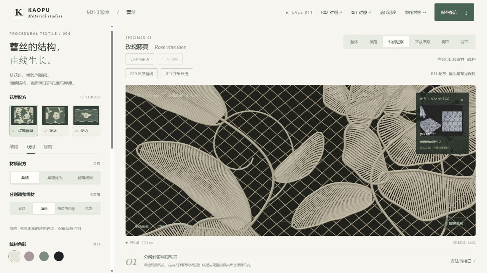

本目录包含独立工作台与精选证据。[源码、构建工具、冻结基线和完整 QA](https://github.com/haihao0307/Human-Fabric-Workbench/tree/codex/lace-visual-controls-20261025/experiments/lace-visual-r11-20261025)在源仓维护。

# KAOPU 蕾丝质感候选 R11

2026-10-25。接续冻结的 R10，视觉优先。**本轮明确解决了已定位的短裁切针脚折叠；新增可调的不规则纤维表面，但整布的规则细杆感仍明显，未通过真实样布质感验收。保持 Draft。**

交付本体是独立 `index.html`，代码、Three.js、shader、样图和样式全部嵌入，核心没有网络依赖。HTTP 后台浏览器已检查；当前会话的浏览器 URL 安全策略阻止 file://，实际双击运行仍未验证。封装通过不能替代这个门槛。

## 已完成的步骤与效果

| 步骤 | 当前效果 | 尚未完成 |
|---|---|---|
| 不规则纤维表面 | 两个真实尺度的相关噪声频段分别影响浅凹凸、色泽和粗糙度；近景多了一些细纹，可按层关闭 | 改善较克制，普通视角仍偏光滑细杆；没有增加真实轮廓纤维 |
| 短针脚曲率保护 | 默认原有的 34 个朝内样点、17 条倒走表面边、1 个反向三角形均降至 0 | 保留了原有开放管口，不能据此声称封闭实体或工艺已通过 |
| 独立调参和恢复 | 纹理立即更新而不重建几何；保护强度、新纹理、布光与镜头完整保存 | 旧 R10 配方继续使用原 R10，不静默迁移 |
| 运行成本核对 | 几何缓冲、根数和三角形不增加；新增可关闭的 GPU 计时诊断 | 计时波动明显，未取得稳定提速或跨设备结论 |

[三布光截图滑动对照](qa/compare.html) · [九条短针脚的独立局部对照](qa/short-stitch-compare.html)。二者都是独立 HTML；前者是原始截图，后者是放大的几何诊断，均不能替代三维工作台或真实样布验收。

## 如何调整

1. “R10 质感基线 / R11 纤维候选”保持花型、尺寸、镜头和布光，切换冻结的材质配方与短针保护。默认纹理强度：柔棉 0.80、丝光 0.12、细网 0.40，底网取各自的一半。
2. “线材 → 不规则纤维纹理”单独调整当前层。归零或缺失时，保留 R10 的原 shader 文本和缓存键；正值只改变表面着色，跨零会切换着色程序，不重建线芯或毛羽。
3. “结构 → 短针脚曲率保护”核心默认 0，R11 工作台候选默认 1。1 是已检查的保护设置；中间值是显式插值，不能保证消除全部局部异常。滑块以 0.01 步进保存中间强度。
4. “平放细察”保持原有 38° 透视镜头与实际毫米线径。先看棚光，再切掠射光和背光；切回整体判断是否只在放大时有效。
5. 保存下载 version 2 完整 JSON，生成器为 `procedural-lace-r11`。实际下载文件已重新载入，恢复填绣纹理 0.43、保护 0.40、弯曲 0、平放镜头；保护滑块未取整。超密失败回退到间距 0.18，并保留这些材质和保护设置。

## 表面纹理的边界

第二候选使用 15 µm / 60 µm 的细纤维与束级频段，名义高度 1.2 µm / 4.5 µm，硬限为线半径的 8%；反射率变化不超过 ±1.5%，粗糙度不超过 ±0.03，再乘当前强度。两档各自按像素足迹过滤，细档先退，闭合路径和圆周接缝保留。它们是**着色凹凸**，不是位移几何、完整纤维 BSDF 或测量拟合。

第一候选近景收益弱，常数和原始截图另行保留。第二候选改善也有限，不宣称已经消除细杆感。大尺度反射与细尺度纹理分开处理的方向参考 [Irawan 与 Marschner 的织物反射研究](https://www.cs.cornell.edu/~srm/publications/TOG12-cloth.html)，本版没有复现论文完整模型。

## 短针脚修复的精确范围

仅检查裁切后的、XY 共线的三点填线；当三点曲率半径小于完整线半径的 4 倍时，约束内部 Z 拱高，完整强度的上限为 `chordXY² / (64 × radius)`。保留 XY、两个端点、完整线径、种子、路径数、采样数及索引拓扑。

默认玫瑰藤蔓共调整 49 条，其中 **9 条是原有缺陷、40 条是按同一判据做的预防调整**；最大内部 Z 改动 0.01548212 mm。花环调整 31 条，花边 0 条。没有删针、缩径或翻法线。21 组实际生成→摆放→绑定→Float32 扫掠检查覆盖三花型、三材质和边界参数，没有新增倒走、反向、退化或非有限表面。更详细的限制、实际点与复现方式见 [修复报告](qa/r11-short-stitches.md)。

## 成本与验证

默认 18 × 22 cm 玫瑰藤蔓柔棉：R10 / R11 都是 **75,025 根毛羽、4,205,464 个总三角形、178,143,936 B 几何缓冲**。内部短针路径变短后，长毛羽的确定性选择有 1 根差异（5,853 → 5,852），根数与半径没有变化；不能称全部毛羽数据逐字节不变。九个花型/材质组合的实际缓冲记录见 `qa/geometry-cost.json`。

131 项检查通过，包含冻结 R10 的零值保留、实际表面缺陷与根附着、噪声闭合/过滤/尺度、光学控制、缓存、状态、计时资源和最终嵌入源码逐一匹配。后台真实 Chromium / ANGLE RTX 4070 Ti SUPER 检查了三花型、三材质、六种视角、三种主要布光、纹理跨零、实际配方往返和预算拒绝。静止截图均收敛至 32 样本；运动 4 / 静止 32 的功能循环已检查，完整运动闪烁仍未验收。

`?profile=gpu` 使用非阻塞 WebGL2 时间查询，默认关闭，不降画质。记录的是包含 4 个空间样本、阴影与合成的一次绘制批次，**不是显示 FPS**。本机同机位各 24 次记录中，R10 / R11 中位数约 10.70 / 10.53 ms，10–90 分位约 7.14–28.07 / 6.76–28.83 ms；范围大幅重叠，不能认定速度变化。原始计时记录注明被测构建散列；之后仅修正了保护滑块的步进，没有改变绘制算法。具体 API 依据 [Khronos 扩展规范](https://registry.khronos.org/webgl/extensions/EXT_disjoint_timer_query_webgl2/)。

## 后续方向

1. 优先减轻整布的规则细杆感，继续校准束纹、轮廓纤维与材质区分，以同尺度真实样布、多布光和整体画面验收。
2. 独立处理裁切端面的开放管口，以及明确工艺的连接与背面载纱。
3. 检查完整运动闪烁、可重复 GPU 计时、其他设备与 file:// 实际双击运行。
4. 最后再接成衣重力、贴合、碰撞和拉伸；当前弯曲仍只是观察用变形。

## 维护与来源

冻结源基线：`Human-Fabric-Workbench@0959b857d5297258e04387b23bed8dca5e141bb5` 的 R10。`tests/baseline-r10/` 保留相关模块，仅显示/毛羽模块的 Three.js 导入重定向到本地 vendor。R05/R08/R09 对照同样保留。旧版目录没有修改。

重建：`python build-standalone.py`；回归：`node --test tests/*.test.mjs`；实际成本：`node tools/measure-r11-cost.mjs`；局部扫掠：`node tools/verify-r11-short-stitches.mjs`；两份独立对照：`python tools/build-comparison.py`、`python tools/build-local-comparison.py`。继承 R10 的其他测量工具只供旧试验复现，不能当作 R11 的成本结论。

`BUILD_MANIFEST.json` 与 `STATUS.json` 分别记录封装散列和完成/未通过门槛。保持 Draft，不合并、不部署、不替换旧线上版本。
