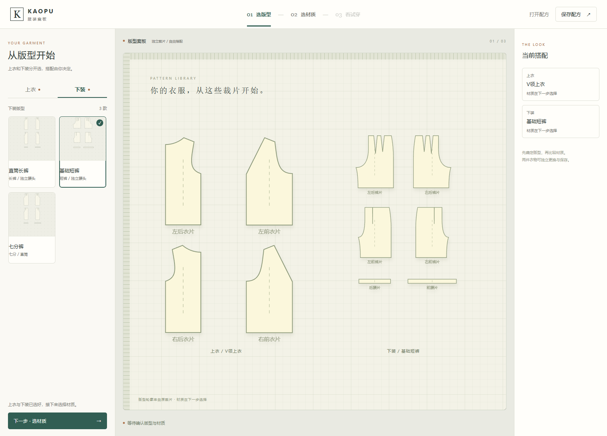

# MP05 R09 · 服装案板

打开后先选上衣和下装版型，再各自选材质，确认后试穿。四款上衣、三款裤型与十二种材质独立管理；配方可保存材质细节。原裁片轮廓直接显示在案板，目录浏览不重复生成衣物。

[打开本地集合](http://127.0.0.1:8897/Human-Clothing-Workbench/%E6%9C%8D%E8%A3%85%E9%9E%8B%E5%B8%BD%E5%B7%A5%E4%BD%9C%E5%8F%B0.html?v=R09-1fb8036d09d9) · [固定公开预览](https://haihao0307.github.io/guilin-dem-pipeline/kaopu-tailor-workbench/material-products/mp05-board-r09-1fb8036d09d9/) · [真实动作录像](qa/R09_服装案板_真实动作.mp4)

裤装修复分两层：补齐原侧缝漏掉的中间材料节点约束；在裆缝邻域的少数长三角形内部追加 26–44 个真实材料接触点，处理运动时的身体穿出。没有补洞背板或额外衣壳。三种裤型的 36 个采样姿态中，检查区域的接缝间隙为 0，最小身体离体距离 0.712 mm。该检查不是连续碰撞或整衣工艺验收。

固定公开版本由本机 Chrome 155 / RTX 4070 Ti SUPER / 1600×1150 / DPR 1 实测，每段 8 秒，计数已完成的真实绘制帧：

| 材料 | 走路 FPS | 跑步 FPS | 反复跳跃 FPS |
| --- | ---: | ---: | ---: |
| 深靛牛仔 | 57.23 | 58.96 | 57.21 |
| 浅洗牛仔 | 54.12 | 59.48 | 53.37 |

实际录像 16.20 秒、875 帧，平均 54.01 FPS；保留原始时间戳，没有插帧或变速。针织、皮革六段动作及十二组版型加载通过；相同固定步进的缓存开关坐标差为 0。完整记录见 [R09 QA](qa/R09_EVIDENCE.json) 与 [开发说明](docs/R09_BOARD_AND_CROTCH.md)。

R08 牛仔放大织纹、浅洗起伏与远距过滤保留。旧集合完整备份已保留在相邻集合项目，旧固定版本保持。人物并行候选文件未纳入此版本。完整自由布料、全自碰撞、CCD、材料标定及七阶段成衣工艺验收仍未完成。
