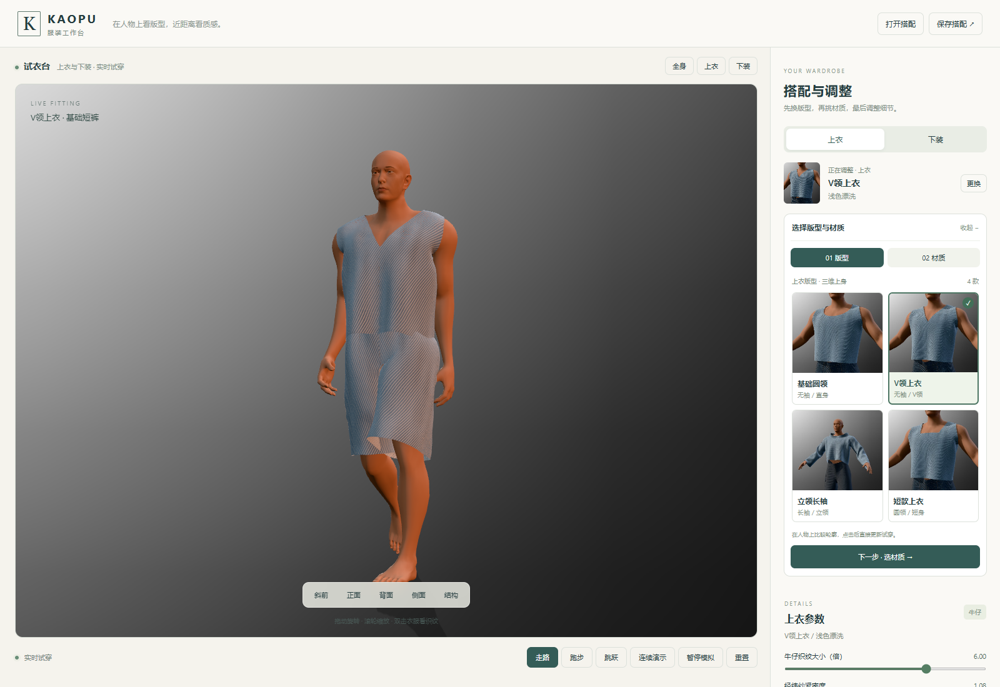

# MP05 R10 · 人物优先的试衣工作台

左中区域展示人物，右侧竖排选择上衣/下装、三维版型和实际材质。默认直接加载 D03 浅洗牛仔搭配。七款版型与十二种材料的 84 张缩略图均由本工作台实际三维衣物和人体渲染；点击材质应用后收起选择区，下面保留对应参数。

[本地集合](http://127.0.0.1:8897/Human-Clothing-Workbench/%E6%9C%8D%E8%A3%85%E9%9E%8B%E5%B8%BD%E5%B7%A5%E4%BD%9C%E5%8F%B0.html?v=R10-3fc034fa91ef) · [固定公开预览](https://haihao0307.github.io/guilin-dem-pipeline/kaopu-tailor-workbench/material-products/mp05-studio-r10-3fc034fa91ef/)

独立换衣、参数应用、折叠、配方恢复、84 张图片解码、1024 和手机布局通过。Chrome / RTX 4070 Ti SUPER / 1600×1100 / DPR1、实际画布1186×885，每段6秒计数已完成的绘制帧：

| 搭配 | 走路 FPS | 跑步 FPS | 跳跃 FPS |
| --- | ---: | ---: | ---: |
| D03 | 54.11 | 50.28 | 56.48 |
| K02 | 41.90 | 43.05 | 43.46 |

针织长袖 K02 的模拟时间仍落后于墙钟（约0.70倍），不能称实时通过；D03 模拟/墙钟约0.99–1.00。帧率受本机同时运行的图形负载影响。

**界面通过不等于布料变形通过。三种裤型的36帧复查确认：裆部过拉、布面塌缩和折叠仍未通过；四种物理试验均被拒绝，尚未修复完成。** [复查详情](docs/R10_DYNAMIC_CLOTH_REVIEW.md)。 快速运行时为骨骼随动加区域次级物理，并非完整自由布料、CCD 或自碰撞；原二维材料的动态主应变约束也未获得认证。R09 接缝与接触的离散采样结果不能替代这些检查。

[开发说明](docs/R10_STUDIO.md) · [UI QA](qa/r10-ui-qa.json) · [原 R09 裆部接触记录](docs/R09_BOARD_AND_CROTCH.md)
