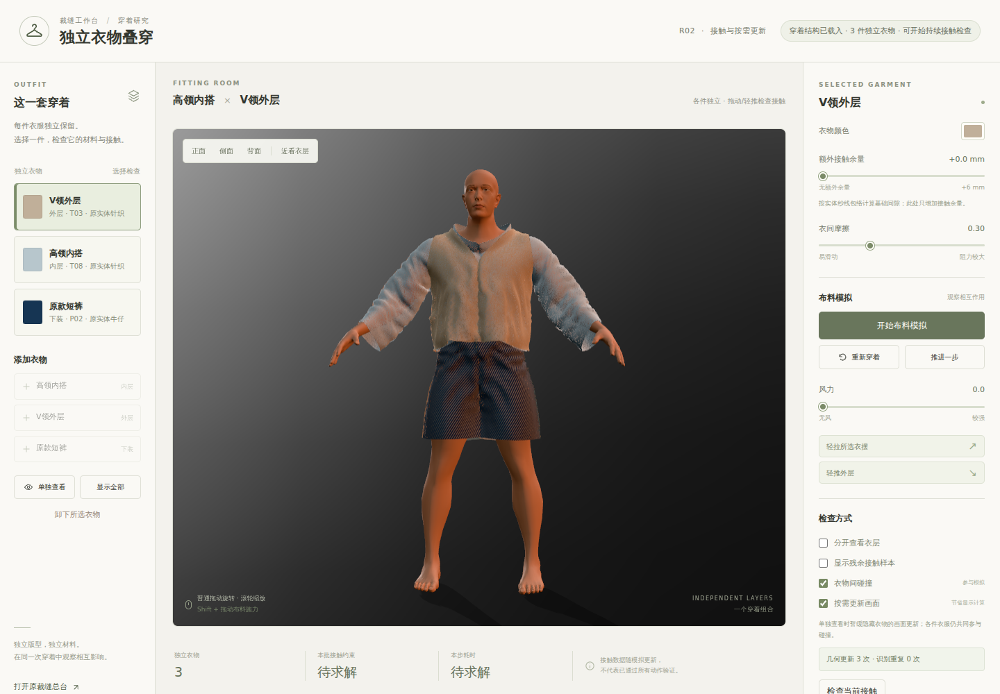
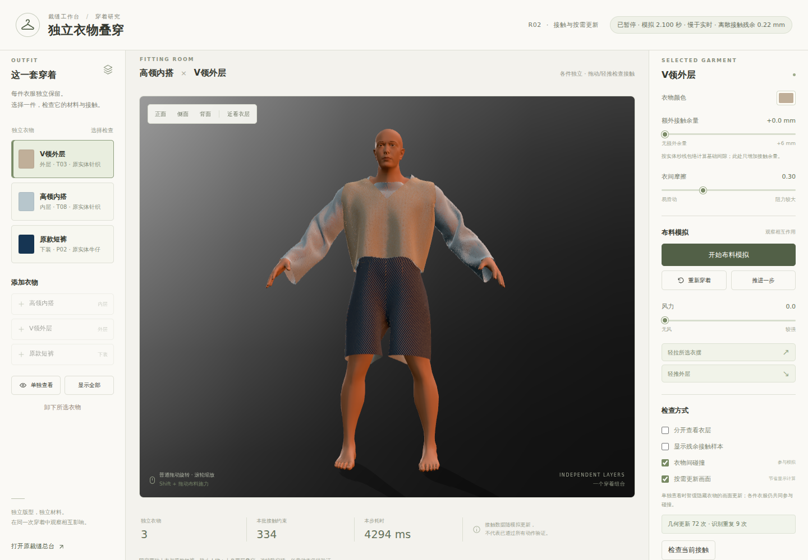

# 叠穿 R02：检查结果与实现说明

[打开这版叠穿工作台](https://haihao0307.github.io/guilin-dem-pipeline/kaopu-tailor-workbench/material-products/layering-r02-20261020-5186f8a/) · [完整机器可读验收报告](VERIFICATION.json) · [本次 CI](https://github.com/haihao0307/guilin-dem-pipeline/actions/runs/39391889463)

## 本次验收

固定源码为 `5186f8a5d71a5e75059539f83a31b2ba1e53042b`，实际 CI checkout 为 `0fea7b956fe359dcdc120b2fc221bc726077763c`。六项完整验收均通过。网页运行代码树为 `43333548e185a89d7b20713cb31062b3d391ed3f`；附加的报告、说明和截图不属于这个运行代码树。

| 检查 | 实际完成 | 结果 |
| --- | --- | --- |
| 原材料与显示 | 初始、单件、换色、近景、分开查看五个真实浏览器画面 | 通过 |
| 按需更新 | OFF / ON / ON / OFF，比较 631,512 个像素，变化 0 个 | 通过 |
| 隐藏后恢复 | 27 步 / 0.225000 秒；隐藏衣物继续运动，恢复最新衣形 | 通过 |
| 浏览器持续模拟 | 252 步 / 2.100000 秒；轻推后另运行 37 步 / 0.308333 秒 | 通过 |
| 脱下与重新穿回 | 完成 3 轮，每轮均有脱下后持续运行和重新穿回后持续运行 | 通过 |
| 原生数值基线 | 240 步 / 2.000000 秒；含初态共 241 个逐状态完整审查 | 通过 |
| 原生数值轻推 / 轻拉 | 240 步 / 2.000000 秒；含初态共 241 个逐状态完整审查 | 通过 |

两组原生数值重放的每个接受状态，均检查完整衣衣／衣身三角相交、全部衣物顶点到人体的距离和独立的整面人体半厚度包络。浏览器几何审查覆盖所保存的选定状态，不能把它描述成每一步的完整三角审查。

| 原生重放 | 最大动态边长比 | 最大衣间残余 | 完整面相交／重叠对数 | 最大人体半厚度缺口 |
| --- | ---: | ---: | ---: | ---: |
| 基线 | 1.449862914 | 0.469670704 mm | 0 | 0.000475206 mm |
| 轻推 / 轻拉 | 1.449862914 | 0.469670704 mm | 0 | 0.000853831 mm |

浏览器各持续区间的数值范围单独列出；它们来自实际 Worker 步回复，初始化、手动测量和单独的轻推动作不计入这组极值。动态边长比门槛为 1.45，衣间厚度残余门槛为 0.5 mm。

| 浏览器场景 | 最大动态边长比 | 最大衣间厚度残余 | 全场景选定完整三角检查状态数 |
| --- | ---: | ---: | ---: |
| 隐藏后恢复 | 1.449862480 | 0.491663173 mm | 6 |
| 持续模拟与轻推后恢复 | 1.449862480 | 0.491663173 mm | 18 |
| 三轮脱下与穿回 | 1.449879412 | 0.498099151 mm | 48 |

| 重穿轮次 | 卸下后实际持续运行 | 穿回后实际持续运行 |
| --- | --- | --- |
| 1 | 29 步 / 0.241667 秒 | 34 步 / 0.283333 秒 |
| 2 | 27 步 / 0.225000 秒 | 31 步 / 0.258333 秒 |
| 3 | 27 步 / 0.225000 秒 | 32 步 / 0.266667 秒 |

## 性能实测

| 原生求解场景 | 每步耗时中位数 | 每步耗时 P95 |
| --- | ---: | ---: |
| 基线 | 3966.873 ms | 4248.219 ms |
| 轻推 / 轻拉 | 3204.350 ms | 3442.005 ms |

分阶段累计耗时显示，衣间接触、人体处理与复测是当前主要瓶颈：

| 阶段 | 占两组累计求解时间 |
| --- | ---: |
| 衣间双向接触 | 41.88% |
| 完整衣面人体厚度包络 | 23.32% |
| 原人体投影 | 12.20% |
| 衣间残余复测 | 8.93% |

[完整性能分析](NATIVE_PERFORMANCE_ANALYSIS.json)记录了输入与日志摘要、各件衣物运动、分位数口径和阶段统计。候选构建属于衣间接触的子项，未重复计入；这些占比来自累计耗时，不是各阶段中位数相加。

这是本次 CI 机器上的实际数值求解耗时，不能视为用户电脑的帧率。当前固定物理步长为 1/120 秒，即每步约 8.333 ms 的实时预算；这版完整接触求解仍慢于实时，页面会显示真实模拟进度。

不同作业的机器执行速度存在差异：两组新原生重放的前 60 步非计时记录完全相同，直到第 61 步加入扰动才分歧，但相同前 60 步的耗时中位数已经不同。因此不能把这两组耗时的比值，或与旧候选作业的比值，解释成单项优化的净加速。

暂停且几何相同的 ABBA 对照中，关闭按需更新的两次动作合计提交 2 个完整画面，开启后的两次合计为 0。每次 OFF 的各件几何更新调用数为 [{"pants": 2, "inner": 2, "outer": 2}, {"pants": 2, "inner": 2, "outer": 2}]；ON 为 [{"pants": 0, "inner": 0, "outer": 0}, {"pants": 0, "inner": 0, "outer": 0}]。这些计数证明避免了重复工作，不能当作持续模拟的加速百分比。

## 怎么检查

先在正常叠穿视图查看领口、肩部和下摆；点击“开始布料模拟”，观察实际模拟秒数推进，再暂停并使用“检查当前接触”。选择外层后，可以“卸下所选衣物”，再从“添加衣物”穿回外层，检查内搭与外套是否仍独立响应。“分开查看衣层”只改变显示位置，便于看清各件衣物。

上图来自本次 display 作业的原始 PNG，拍摄于物理时间 0；持续模拟与重穿结论来自相应数值和浏览器验收，不由初态图片推断。

上图来自本次 continuous 作业的原始 PNG，完成 252 个模拟步、物理时间 2.100000 秒后暂停。截图用于核对材料与外观，几何结论见相应完整检查记录。

这次修复保留原人物、皮肤、查看器、各件衣物的纸样与连续实体纱线。内搭、外套和短裤仍是独立衣物，在同一物理时间步中相互接触，可以单独选择、换色、脱下和重新穿回。

## 穿模原因与修复

接触检测原先会把内部三角边、合法绕过领口或下摆的近距接触误当成穿越；后续布片拉伸、衣间分离和人体投影又会互相破坏。R02 区分真实开口与网格内部边，普通近距接触使用实际距离，只有在有限特征上确认的扫掠穿越才建立有向接触历史。人体约束检查完整衣面与真实人体，而不只检查少量采样点。

重新穿回外套还暴露了另一处问题：外套一条短边超限，会触发所有衣物的额外应变修复，继续把已合格的内搭和短裤拉紧，接触修正随后又把它们推开。现在额外修复会跟踪本衣超限边及受影响的邻边，一旦回到原有硬门槛就停止；初始化、每步主材料约束、质量、纸样长度和接触厚度均保留原值。

每轮最后同时检查拉伸、衣间间距和人体厚度。若在工作上限内仍未合格，恢复上一步衣形、速度与接触历史并显示错误，物理时钟不前进。错误测量与回滚后的画面分别保存。

## 已经省掉的工作

| 情况 | R02 的处理 | 保留的必要工作 |
| --- | --- | --- |
| 收到完全相同的衣形、法线与拓扑 | 精确比较后跳过重复几何更新 | 真实变化仍会呈现 |
| 一个画面还在绘制，连续收到多份物理结果 | 合并等待呈现的结果，显示最新状态 | 物理仍按固定步长顺序计算 |
| 用户明确隐藏衣物，包括单件查看时的其他衣物 | 延迟几何上传、纱线更新与相关显示请求 | 仍参加衣间和人体接触；恢复显示前更新到最新衣形 |
| 已从穿搭中脱下的衣物 | 移除物理对象，释放该件的显示几何和材料资源 | 保留纸样准备缓存，方便再次穿回 |
| 确认不可能靠近的布面候选 | 先用含本步位移的包围盒排除，再进行精确最近点检查 | 有效接触与未解决的穿越继续检查 |
| 联合收敛后，只有速度发生更新 | 复用刚完成的接触测量，省掉一次相同几何的完整扫描 | 手动检查仍进行当前状态的新测量 |
| 已满足硬门槛的衣物 | 停止其额外尾部应变修复 | 每步完整主材料约束仍执行 |
| 只用于纸样坐标对齐的旧人物参考包 | 改用原始位置和三角索引字节包 | 当前可见人物、皮肤和真实碰撞体保留 |
| 已结束过渡的旧纱线图集 | 在原过渡期结束后释放 | 现用图集、原纱线形态和着色质量保留 |

旧坐标参考包由 3,220,845 字节改为 512,124 字节几何包及 2,094 字节描述，净减少 2,706,627 字节下载。这个数字只对应旧参考包，不代表整个网页大小或显存减少量。

全站统计口径：本次运行文件共 307 个、合计 106,225,767 字节，包含保留的上游资源。单次访问实际会请求其中一部分文件；本次验收记录了请求、状态码和参考包的精确字节，但没有独立测量整站网络传输字节，因此这里不宣称整站首次加载的总量或提速比例。

## “被外套盖住”还不足以直接停算

领口、袖口、下摆和针织孔洞仍可能露出内层，内层也会撑起外层的形状。R02 目前采用可证明的相同状态跳过和显式隐藏处理，尚未自动剔除被外套覆盖的局部区域，也没有让内层进入物理睡眠。

若继续做自动局部遮挡，需要同时考虑当前视角、真实孔洞、阴影和衣物运动，并在可能露出前恢复显示数据。若做物理睡眠，则应依据速度、约束误差和稳定时间，以及身体、相邻衣物和用户操作的唤醒条件。单凭当前不可见而停算，会改变叠穿关系。

## 检查范围与性能解读

最终数值、时间、源码身份和浏览器截图以同目录的 `VERIFICATION.json` 及本次 CI 为准。每个原生重放接受步的完整三角与人体厚度检查，和浏览器选定状态的几何检查应分别理解。

按需更新可以减少无变化时的上传和绘制；它不能代表持续物理模拟已达到实时。应分别看实际物理步耗时、绘制工作量、加载量和像素一致性。当前实现也不构成任意动作、连续时间、自碰撞或逐根渲染纱线无碰撞的保证。

## 研究依据

- [SideFX Vellum Solver](https://www.sidefx.com/docs/houdini/nodes/sop/vellumsolver.html)：分层碰撞、约束交替、碰撞后的清理和按稳定时间判定休眠。R02 没有直接采用其改变层质量的 Layer Shock，也未启用物理睡眠。
- [NVIDIA FleX Manual](https://nvidiagameworks.github.io/FleX/1.2/lib_docs/manual.html)：粒子激活集合、约束引用及碰撞余量的成本。减少活跃对象需要同时处理约束关系。
- [GPU Gems 2：Hardware Occlusion Queries Made Useful](https://developer.nvidia.com/gpugems/gpugems2/part-i-geometric-complexity/chapter-6-hardware-occlusion-queries-made-useful)：保守可见性、时间连续性以及等待遮挡查询造成的开销。具体到针织孔洞与叠穿边缘的保留策略，是对本项目的工程判断。
