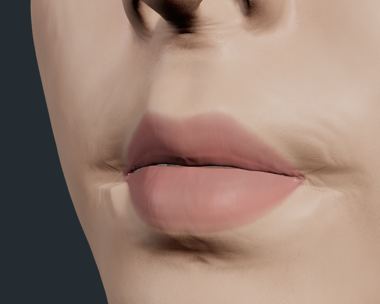
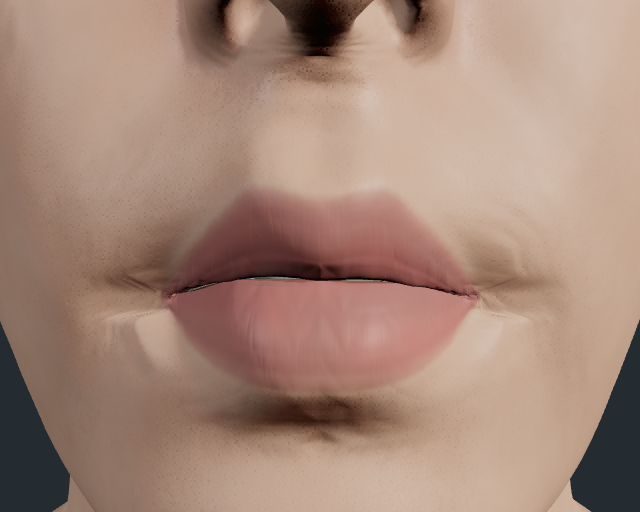

# R06：口角噘嘴连续性修复

**已完成并保留 candidate-03 的局部修复。** 固定人物在 75%／100% 噘嘴时，口角下外侧的硬亮折减轻；第二候选新增的外上方阶梯横纹和角状暗凹也明显缓和。中央唇体、聚拢动作及已验证的 R05 行为保留。整个嘴唇的真实感尚未通过。

[打开固定 R06 工作台](https://htmlpreview.github.io/?https://raw.githubusercontent.com/haihao0307/guilin-dem-pipeline/1237284ea60f9c198b2b63543f098a7551a9af2f/kaopu-unified-human-workbench/lip-corner-r06/preview.html) · [R05 固定对照](https://htmlpreview.github.io/?https://raw.githubusercontent.com/haihao0307/guilin-dem-pipeline/11ed0391f798b5323f4eb4aefec4307fc0b9aee0/kaopu-unified-human-workbench/lip-motion-r05/preview.html) · [Draft PR #314](https://github.com/haihao0307/guilin-dem-pipeline/pull/314) · [实际网页验证记录](https://github.com/haihao0307/guilin-dem-pipeline/actions/runs/39384889715)

## 怎样看实际效果

打开后默认是同一人物的满进度噘嘴斜侧视角。在“嘴唇口角”面板切换 **本次修复 R06 / 修复前 R05**，先观察两侧口角下外方，再观察口角上外方。用“动作进度”查看 25%、50%、75%、100%，并切换“嘴部正面”和“嘴部斜侧”。原生人物及继承资源仍需联网加载。

以下是 CI 真实原生渲染的完整 640×512 原图，没有生成图、修图或截取局部来代替验收：

| 修复前 R05 | 保留版 R06 |
|---|---|
|  |  |
|  |  |

## 问题、依据与改动

本轮首先处理动作中的口角外围过渡。原生噘嘴位移在活动区域边界外停止，但边界内仍有剩余位移；源码和原生网格检查支持这里存在运动不连续。诊断关闭横向收缩时折痕变化最大，却同时削弱噘嘴，不能作为修复。原生求值网格与绘制网格的索引并非一一对应，因此没有把某个屏幕像素武断归到一条指定边。

保留版从当前原生阶段提取“其余动作保持不变、仅加入噘嘴”产生的横向、上下和前突增量，以同一个原生静止网格算子向符合条件的外围皮肤重新分配。原始唇体、内缘、49 对接触采样及中心保护区保持约束，之后继续执行原有闭合、R05 内缘修复、法线及细节阶段。4mm 是工程平滑尺度，不是组织参数测量，也不是距嘴唇 4mm 的硬截断。

修复涉及运动引起的原生几何变化；材质、湿润度、贴图、灯光、相机和静止形状保持不变。这样可以把视觉改善归到本次运动改动，避免用外观参数遮住折面。

## 为什么做了三版

| 候选 | 观察结果 | 决定 |
|---|---|---|
| candidate-01 | 只让原本不活动的外围点跟随，主要硬折改善不足；公开验证还出现一次必要资源 `net::ERR_ABORTED`，原因未证实。 | 拒绝；保留失败证据。 |
| candidate-02 | 横向修正减轻下方亮折，15 项技术检查通过，但高进度新增阶梯横纹、堆叠脊和角状暗凹。 | 拒绝；几何审查曾支持更窄的保留范围，该异议也保留。 |
| candidate-03 | 保留第二版的图、保护区和横向求解，同时传递上下及前突增量。主要亮折和第二版的副作用均减轻，动作未见明显变弱。 | 保留此局部修复；整体真实感不通过。 |

横向求解报告和已记录的全部横向样例与第二版逐数一致，支持第三版收益来自上下／前突的联合改动；没有单独分离两者贡献，也没有把离散样例当作全数组独立哈希证明。

## 实际验证结果

- 固定提交的公开 HTTPS 网页验证 **15/15 通过**，保存 **20 张原生帧**、记录 **21 次原生 GPU 读回**，另有 **1 张实际工作台截图**。
- 页面错误、控制台错误、失败请求、资源错误均为 **0**；浏览器清理和断开完成。
- 中性、张口和说话的已测完整状态与像素精确一致。噘嘴检查覆盖斜视 25%／50%／75%／100% 和满进度正面。
- 每组噘嘴实际测量 7,431 个原本活动的外围顶点，原生源位移与预测值的全部样本在 Float32 舍入容差内一致；满进度三个分量迭代 132／133／132 次，没有钳制或越界。这验证实现，不代表真实组织模型正确。
- 69,079 个唇体及邻接保护点、98 个原始接触点和 65,576 个中心点没有直接修正；49 对接触采样最终位置保持一致。集合可能重叠，不能把数量相加当作总保护点数。
- 原始拓扑、静止几何、实际编译着色器及 15 组原生 uniform 对象保持；独立加载的固定 R05 与 R06 关闭修复后的状态和画面一致。
- 工作台、头部和身体三个真实保存入口生成完全相同的完整人物档案。新浏览器上下文恢复 50% 噘嘴后，状态、控制面板和画面一致。**画面对照显式对齐了相机与灯光；人物存档不拥有这两项。** 未知及空档案在修改人物前被拒绝。

技术结果、root 原图审核与三个独立复核分开记录。原始 QA 中 `visualAcceptance=false`、`productionReady=false` 及构建时的待验证状态保留不改；本次有边界的保留决定见 [FINAL_RECEIPT.json](FINAL_RECEIPT.json)，不把局部收益升级为整个嘴唇验收通过。

## 仍然存在的问题

口角尖端、左上暗沟和右角细褶仍在；内唇缘偏薄，外唇有蜡感，灰色块状牙齿及口腔壁需要继续审核。本次没有证明组织厚度、体积守恒、全局无穿插、生物力学正确、跨人物通用性、任意混合动作或实机性能。离散动作采样也不等于完整连续动画已验收。

下一轮优先审核唇缘厚度与内外翻转／接触的结构依据，明确哪些是原始几何问题、哪些才需要材质处理。本次没有同时加入未经验证的下一轮改动。

## 可复查的记录

- [root 最终审核](research/candidate-03-root-final-review.json)
- [独立视觉审核](research/candidate-03-visual-review.json)
- [独立几何审核](research/candidate-03-geometry-review.json)
- [独立技术审核](research/candidate-03-technical-review.json)
- [原始实际 QA](evidence/candidate-03/qa.json)
- [第一候选拒绝](CANDIDATE_01_REJECTION.json) / [第二候选拒绝](CANDIDATE_02_REJECTION.json)

源码提交：`1e1e216c2005f4c318da190e1b3b160cc4bd4a6d`；公开构建：`1237284ea60f9c198b2b63543f098a7551a9af2f`；实际证据：`b842748b5ceb8bec0c0809d91d850071e2a53412`。最终交付记录仅补充审核与说明，产品和原始证据保持上述固定提交。Draft #314 基于 R05，未合并，历史未重写。

这轮对系统的改进是让每次修改都关联具体运动来源、保护边界、可反驳的假设、真实画面对照和保留／拒绝理由。先前失败不会被新的“通过”覆盖，后续搭建能复用已证明的部分，也能避开已记录的失败方案。
